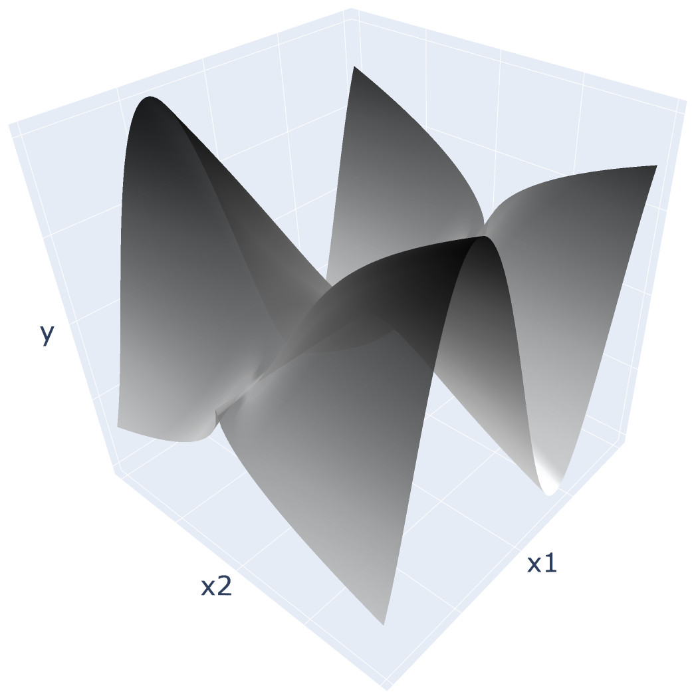

# Toybox-Data

## Overview
This repository contains the dataset ($x_1, x_2, y$) that create the Toybox Surface from the paper
> **Daisy Bradley, Nathan Hinchliffe, Daniel Pitchforth, Matthew Jones and Elizabeth Cross** (2026). *From Grey-Box to Green-Box: When can Physics-Informed Machine Learning Reduce Carbon Footprints in Structural Health Monitoring?* [[arXiV link](https://arxiv.org/pdf/2609.33387)]

## The Toybox Surface

See the surface below:

Defined by the equation $y = \sqrt{|x_2|} \sin(4x_1)$

## The Dataset

* **File:** `toybox_data.csv`
* **Format:** Comma-Separated Values (`.csv`)

Contains the x1, x2 and y variables
x1 and x2 have been flattened from their original generation as a mesh grid
